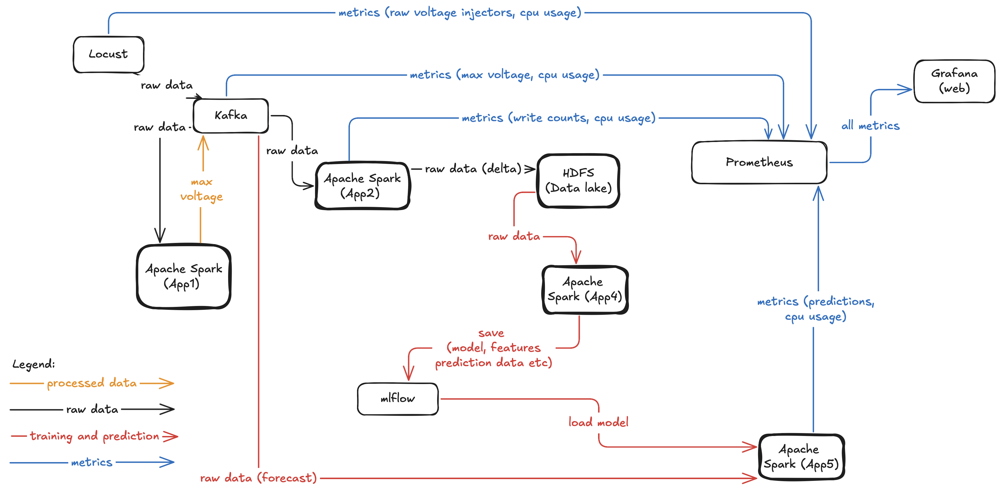
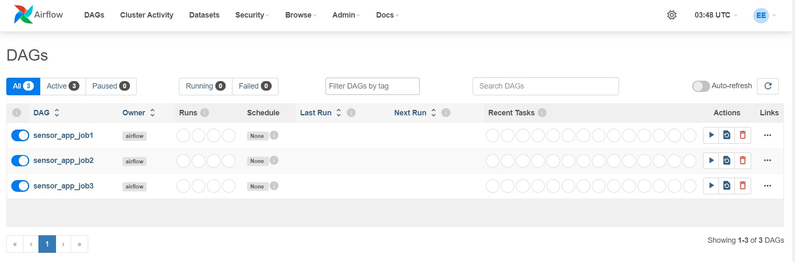
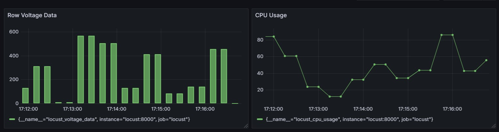

# Team Project: Smart-Meter Application Upgrade

**Course:** MGL7320 - Software Engineering for Artificial Intelligence Systems
**Instructor:** Laurent Yves Magnin ([magnin.laurent_yves@uqam.ca](mailto:magnin.laurent_yves@uqam.ca))

**GitHub Organization:** [](https://github.com/uqam-lomagnin)
**Team Name:** [](https://github.com/orgs/uqam-lomagnin/teams/r00tai)
**Project GitHub:** [](https://github.com/uqam-lomagnin/smartmeter-r00tai)

---

## Team Members

| Name and Surname | Student Email | GitHub Username | Study Program |
| :--- | :--- | :--- | :--- |
| Francois Gonothi Toure | toure.francois_gonothi@courrier.uqam.ca | @gtfrans2re | M.Sc. in Computer Science (Artificial Intelligence) |
| Ben Bachir Aboubakar Nabil | aboubakar_nabil.ben_bachir@courrier.uqam.ca | @BenBachirAboubakarNabil | M.Sc. in Software Engineering |
| Martial Zachee Kaljob Kollo | kaljob_kollo.martial_zachee@courrier.uqam.ca | @kaljob | M.Sc. in Computer Science (AI and Data Management) |
| Sokhna Mariame Ndour | ndour.sokhna_mariame@courrier.uqam.ca | @zeyda97 | M.Sc. in Computer Science (Artificial Intelligence) |

---

## Overview

An end-to-end streaming data platform that simulates a fleet of smart electricity
meters, ingests their readings in real time, stores them in a data lake, trains a
voltage-prediction model and serves predictions — with monitoring and orchestration.

The whole stack runs locally with a single `docker compose up`.

```
Locust ──► Kafka ──► Spark (stream) ──► HDFS data lake ──► Spark (train) ──► MLflow + HDFS model
                        │                                                         │
                        └── max-voltage ──► Kafka                   Spark (serve) ─┘──► Kafka predictions
Airflow orchestrates the Spark jobs · Prometheus + Grafana monitor everything
```



---

## The canonical data contract

The single most important thing to know when working on this project: **one topic,
one message schema**, agreed on by the Locust producer and every Spark consumer.

| | Value |
| :--- | :--- |
| Raw ingest topic | `sensor-data` (created by `src/scripts/kafka-init-topic.sh`) |
| Message payload | `{"meter_id": <int>, "voltage": <float>, "timestamp": <float epoch seconds>}` (JSON, UTF-8) |
| Forecast topic (app5 input) | `forecast-data` |
| Prediction topic (app5 output) | `predictions-topic` |
| Max-voltage topic (app1 output) | `processed-voltage` |

If a producer and a consumer disagree on the topic name or the payload shape, **no
data flows** — this was the main reason the original project was hard to reproduce.

---

## Repository layout

```
.
├── docker-compose.yml              # The whole stack (14 services)
├── src/
│   ├── app/
│   │   ├── locust/                 # Load generator -> produces to Kafka
│   │   │   └── smart_meter_locustfile.py
│   │   ├── kafka/                  # Standalone producer/consumer test scripts
│   │   ├── spark/
│   │   │   ├── common/             # Reader / Writer / Utilities / config
│   │   │   └── jobs/               # spark_app1..5 (the pipeline stages)
│   │   └── airflow/dags/           # One DAG per Spark job + spark_defaults.py
│   ├── infra/                      # Dockerfiles, env files, Prometheus, metastore init
│   ├── scripts/                    # Kafka topic init, Airflow<->Spark connection
│   └── logs/airflow/               # Airflow logs (bind-mounted)
└── images/                         # Architecture & screenshots
```

### The five Spark jobs

| Job | Type | Reads | Writes |
| :--- | :--- | :--- | :--- |
| `spark_app1` | streaming | `sensor-data` | max voltage / 1-min window → `processed-voltage` + Prometheus `:8001` |
| `spark_app2` | streaming | `sensor-data` | parsed readings → HDFS parquet (`/user/hive/warehouse/ddd`) |
| `spark_app3` | batch | — | registers Hive external table `default.ddd` over the parquet folder |
| `spark_app4` | batch | HDFS `ddd` folder | trains LinearRegression, logs to MLflow, saves model to HDFS |
| `spark_app5` | streaming | `forecast-data` + HDFS model | predictions → `predictions-topic` + Prometheus `:8005` |

---

## Prerequisites

- **Docker** ≥ 24 and **Docker Compose v2** (`docker compose version`).
- **RAM:** ~10–12 GB free for the full stack (Kafka + Spark + HDFS + Airflow + MLflow
  + Prometheus/Grafana). On an 8 GB machine, start the heavy services in stages (see
  Troubleshooting).
- **Disk:** ~15 GB (images + the Airflow image builds its own Spark install).
- **Free ports:** 2181, 3000, 5001, 7077, 8000, 8080, 8089, 9000, 9090, 9091, 9092,
  9095, 9870, 29092.
- Internet access on first run: the Airflow image downloads Spark, and the Spark jobs
  fetch the Kafka/Postgres jars from Maven the first time they are submitted.

---

## Quick start

```bash
git clone https://github.com/gtfrans2re/smartmeter.git
cd smartmeter

# Build the custom images (Airflow-with-Spark, Locust) and start everything.
docker compose up -d --build

# Watch services become healthy (first build can take 10–15 min).
docker compose ps
```

The Airflow scheduler automatically runs `airflow db migrate`, creates the
`spark_default` connection and an **admin / admin** web user on first start.

### Service URLs

| Service | URL | Credentials |
| :--- | :--- | :--- |
| Airflow | http://localhost:9095 | admin / admin |
| Locust | http://localhost:8089 | — |
| Spark master | http://localhost:8080 | — |
| HDFS NameNode | http://localhost:9870 | — |
| MLflow | http://localhost:5001 | — |
| Prometheus | http://localhost:9090 | — |
| Grafana | http://localhost:3000 | admin / admin |

---

## Running the pipeline

Once all containers are up:

**1. Generate data.** Open Locust at http://localhost:8089, set the number of users
(e.g. 50) and spawn rate, and start the swarm. It produces readings to `sensor-data`.
Verify messages are flowing:

```bash
docker compose exec kafka kafka-console-consumer \
  --bootstrap-server kafka:9092 --topic sensor-data --max-messages 5
```

**2. Start ingestion.** In Airflow, trigger **`sensor_app_job2`** (streaming — it keeps
running and appends parquet to HDFS). Check the lake fills up:

```bash
docker compose exec namenode hdfs dfs -ls /user/hive/warehouse/ddd
```

**3. (Optional) Register the Hive table.** Trigger **`sensor_app_job3`** to create
`default.ddd` over the parquet folder for ad-hoc SQL.

**4. Aggregate.** Trigger **`sensor_app_job1`** for the per-minute max-voltage stream
(published to `processed-voltage`, exposed to Prometheus).

**5. Train.** Once some data has landed, trigger **`sensor_app_job4`**. It trains the
model, logs it to MLflow (see http://localhost:5001) and saves it to HDFS under
`/user/models/model_lr`.

**6. Serve.** Trigger **`sensor_app_job5`** to load the model and predict on the
`forecast-data` stream, publishing to `predictions-topic`:

```bash
docker compose exec kafka kafka-console-consumer \
  --bootstrap-server kafka:9092 --topic predictions-topic --max-messages 5
```

> `job1`, `job2` and `job5` are **long-running streams** — in Airflow they stay in the
> *running* state by design. `job3` and `job4` are batch and finish on their own.

---

## Monitoring

- **Prometheus** (http://localhost:9090) scrapes Locust (`:8000`), the Spark master/worker,
  and the app1/app5 driver metrics (exposed on the Airflow scheduler container at
  `:8001`/`:8005`).
- **Grafana** (http://localhost:3000, admin/admin): add Prometheus (`http://prometheus:9090`)
  as a data source, then build panels on the `locust_*` and `spark_app*` metrics.




---

## Troubleshooting

| Symptom | Fix |
| :--- | :--- |
| Airflow logs show permission errors | `mkdir -p src/logs/airflow && chmod -R 777 src/logs` before `up`, or set `AIRFLOW_UID` to your UID. |
| HDFS writes fail with *safe mode* | Wait for the NameNode to exit safe mode, or `docker compose exec namenode hdfs dfsadmin -safemode leave`. |
| `job4` exits with "No data in the lake yet" | Let Locust + `job2` run for a minute first so parquet lands in `/user/hive/warehouse/ddd`. |
| Spark job can't download the Kafka/Postgres jars | First submit needs internet (Maven). Re-trigger once the download completes; jars are cached in `/opt/ivy2`. |
| `ModuleNotFoundError: app.spark.common` in a Spark job | The driver needs `PYTHONPATH=/opt/airflow` (set in compose + each DAG). Rebuild if you changed the image. |
| 8 GB RAM machine | Bring up the stack in stages: `docker compose up -d zookeeper kafka namenode datanode postgres`, then `spark-master spark-worker mlflow`, then `airflow-scheduler airflow-webserver locust prometheus grafana`. |

---

## Notes for maintainers

This upgrade made the project reproducible end to end. The key changes vs. the
original:

- **Networking:** every service is now on one `monitoring` network, and the duplicate
  `namenode` alias on `spark-master` was removed (it broke HDFS name resolution).
- **Topic/schema alignment:** Locust and the Spark jobs now share the single
  `sensor-data` contract above (previously they used different topics, so no data
  reached Spark).
- **MLflow** is reachable at `http://mlflow:5000` inside the network (host `:5001`).
- **Hive metastore** is backed by a dedicated `metastore` database in the existing
  Postgres (no separate thrift server); the training path reads parquet directly and
  does not depend on it.
- **Trimmed** the unused YARN services (Spark runs standalone) to fit a laptop, and
  completed/fixed `spark_app4` (training) and `spark_app5` (serving), each with its
  own DAG.

The Spark data logic (parsing, windowed aggregation, training, prediction) was verified
in local mode. The full containerised stack should be validated on your machine with
the steps above.
```
The original note about Prometheus/Grafana not being fully wired still partly applies:
the metric endpoints are configured, but Grafana dashboards are set up manually.
```
